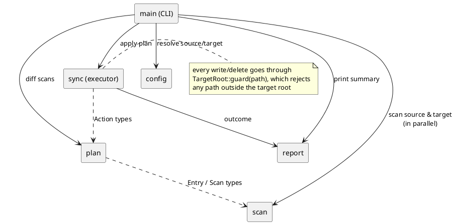
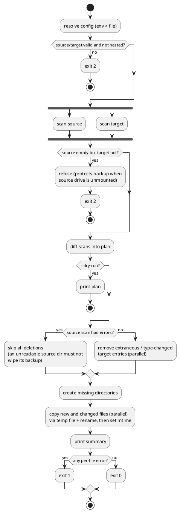
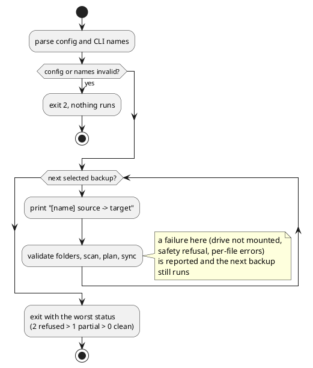

# backsync - implementation plan

`backsync` is a one-way mirror CLI: it makes a target folder (for example a portable drive) an exact copy of a source folder, as fast as possible, without ever modifying the source.

## Goals

| # | Requirement | How it is met |
|---|-------------|---------------|
| 1 | Source and target come from a config file or env, env wins | `config` module resolves each field independently: `BACKSYNC_SOURCE` / `BACKSYNC_TARGET` override `source` / `target` in the TOML file |
| 2 | Skip identical files, copy missing ones, delete files removed from source | `plan` module diffs two scans into a list of actions |
| 3 | Same tree structure, updated files overwrite the backup | relative paths are preserved; changed files are replaced atomically |
| 4 | Written in Rust | single binary crate |
| 5 | Git repo under `~/repo`, author Shaun Wen `<shaunwen01@gmail.com>` | repo-local git config |
| 6 | Plan first, PlantUML diagrams | this document |
| 7 | Small commits | one commit per module / concern |
| 8 | Binary installed to `~/workspace/bin` | `make install` |
| 9 | Fast, parallel | parallel directory walk (`jwalk`) and parallel copy/delete (`rayon`) |
| 10 | Never delete anything in the source | source is only ever read; every write or delete goes through a guard that refuses paths outside the target root |

## Usage

```bash
backsync                 # sync using env / config
backsync --dry-run       # print what would happen, change nothing
backsync --verbose       # print every action taken
backsync --checksum      # compare file contents instead of size + mtime
backsync --jobs N        # parallel copy jobs (default 4)
backsync --config PATH   # use a config file other than the default
```

Config file, default `~/.config/backsync/config.toml` (or `$XDG_CONFIG_HOME/backsync/config.toml`):

```toml
source = "~/Documents"
target = "/Volumes/Backup/Documents"
# optional, seconds of mtime difference still treated as "same file" (default 2)
modify_window_secs = 2
# optional, parallel copy jobs (default 4); --jobs overrides it
jobs = 4
```

Env overrides: `BACKSYNC_SOURCE`, `BACKSYNC_TARGET`. A leading `~/` is expanded in both.

Exit codes: `0` success, `1` finished with per-file errors, `2` configuration or safety error (nothing was changed).

## Architecture



| Module | Responsibility |
|--------|----------------|
| `config` | Read the TOML file, overlay env, expand `~`, validate paths, enforce safety rules |
| `scan` | Walk a root in parallel and return `relative path -> Entry` (file with size + mtime, dir, symlink with link text) plus scan errors |
| `plan` | Pure diff of two scans into `Plan { remove, mkdir, copy, unchanged }`. No IO except the optional content comparator |
| `sync` | Execute a plan in parallel, collect per-path errors |
| `report` | Count and format the summary, verbose and dry-run lines |

## Sync flow



## Key decisions

### What counts as "the same file"

Default: same size **and** mtime within `modify_window_secs` (default 2 s). This is the rsync approach and avoids reading file contents, so unchanged files cost one `stat` each. The window absorbs coarse timestamps on portable drive file systems (FAT32 stores 2 s, HFS+ 1 s, exFAT 10 ms). After every copy the target mtime is set to the source mtime, so the next run sees the file as unchanged.

`--checksum`: same-size files are compared chunk by chunk, in parallel, stopping at the first difference. Slower, but catches a change that kept both size and mtime.

### Atomic replacement

A file is copied to `.backsync-tmp.<pid>.<n>` in the destination directory (short, so long file names never exceed the 255-byte limit), its mtime is set, then it is renamed over the final name. An interrupted run never leaves a half-written file under the real name. Leftover temp files are not in the source, so the next run deletes them as extraneous.

### Deletion and type changes

- Target entries that are missing from the source are deleted.
- If an entry changed type (file <-> dir <-> symlink), the target entry is removed and recreated.
- Only the topmost extraneous directory is removed (`remove_dir_all`); its children are not deleted one by one.
- Deletions run before copies, which frees space on a full drive and clears type conflicts.

### Safety rules

1. The source is opened read-only. No code path writes to or deletes from it.
2. `TargetRoot::guard` canonicalizes the target root once and rejects any write or delete whose path is not strictly inside it.
3. Source and target must both exist, be directories, be different, and not be nested in each other. A source inside the target would otherwise be deleted as extraneous, and a target inside the source would be copied into itself.
4. The target root must already exist; it is never created. If the portable drive is not mounted, `/Volumes/Backup/...` is missing and the run stops instead of filling the internal disk.
5. An empty source with a non-empty target is refused (exit 2), because it usually means the source is an unmounted drive. `--allow-empty-source` overrides this.
6. If any part of the source cannot be read, no deletions happen in that run.
7. macOS volume metadata at the target root (`.Spotlight-V100`, `.Trashes`, `.fseventsd`, `.TemporaryItems`, `.DocumentRevisions-V100`) is never scanned, copied or deleted.

### Symlinks and special files

Symlinks are copied as links (never followed), compared by link text. Sockets, FIFOs and device files are skipped with a warning.

### Parallelism

- Source and target are scanned at the same time, each with `jwalk`, which reads directories on a rayon thread pool.
- Removals and copies run with `rayon` parallel iterators. Directory creation is sequential (cheap, ordering matters).
- `fs::copy` on macOS uses `fclonefileat`/`fcopyfile`, so same-volume copies are clones and cross-volume copies are kernel-side.

## Crates

| Crate | Use |
|-------|-----|
| `clap` (derive) | CLI parsing |
| `serde`, `toml` | config file |
| `jwalk` | parallel directory walking |
| `rayon` | parallel copy / delete / hashing |
| `filetime` | set mtime after copy |
| `unicode-normalization` | compare names in NFC form on macOS |
| `anyhow` | error context in the binary |
| `tempfile`, `assert_cmd`, `predicates` (dev) | end-to-end tests |

## Testing

All tests follow GIVEN / WHEN / THEN.

- **Unit:** config precedence (env injected as a lookup function, no global env mutation), `~` expansion, nesting and existence validation, plan diff for every case (new, changed size, changed mtime, within window, removed file, removed dir, type change, symlink change), guard rejection of outside paths.
- **End-to-end** (`tests/cli.rs`, runs the real binary against temp dirs):
  - first sync copies a nested tree
  - second sync is a no-op (target file inodes and mtimes unchanged)
  - updated file overwrites backup, preserving tree
  - deleted file and deleted directory are removed from target
  - source tree is byte-for-byte unchanged after every run
  - env overrides config file
  - missing target root, nested paths, empty source are refused with exit 2
  - `--dry-run` changes nothing
  - `--checksum` detects same-size, same-mtime content change
  - symlinks are mirrored as links
  - stale `.backsync-tmp.*` files are cleaned up
- **Lint:** `cargo fmt --check`, `cargo clippy --all-targets -- -D warnings`.
- **Performance check:** manual run on a generated tree (tens of thousands of files) to confirm a no-op resync is near instant.

## Commit sequence

1. `docs: add implementation plan`
2. `chore: scaffold cargo project`
3. `feat(config): resolve source and target from env and config file`
4. `feat(scan): parallel directory scanning`
5. `feat(plan): diff scans into sync actions`
6. `feat(sync): execute plan in parallel with target guard`
7. `feat(cli): wire commands, summary and exit codes`
8. `test: end-to-end sync scenarios`
9. `build: make install to ~/workspace/bin`
10. `docs: README`

## Changes during implementation

Testing against real disk images (an APFS volume and an exFAT volume created with `hdiutil`, standing in for a portable drive) changed several decisions:

| Finding | Change |
|---------|--------|
| `jwalk` shared the global rayon pool with the `rayon::join` running both scans; with a small pool it aborted with "thread-pool too busy" and the run copied nothing | each scan walks on its own pool; scans run on scoped threads |
| Using every core for copies was slower: 50k files / 1.1 GiB to a separate APFS volume took 16.0 s (1 job), 9.5 s (2), 8.1 s (4), 8.0 s (8, twice the kernel time), 11.2 s (12) | copies run on a dedicated pool, `--jobs` / `jobs`, default 4 |
| A full target produced one error per remaining file | the first out-of-space error stops further copies; the summary counts copies not attempted |
| exFAT stores extended attributes in `._<name>` AppleDouble files, so every resync deleted thousands of them and the next copy recreated them | a target-only `._X` is kept while `X` is mirrored |
| exFAT folder listings shift during deletion, so `remove_dir_all` left files behind ("Directory not empty") | folder removal retries until the tree is gone; an entry that has already vanished counts as removed |
| exFAT lists names decomposed (NFD) while APFS keeps composed (NFC) names, so accented files were deleted and recopied on every run | on macOS entries are compared by NFC key; real on-disk names are kept for all IO |
| Hashing both files with blake3 reads both files fully | chunked comparison stops at the first difference and needs no dependency |

Results on the final build: a no-op resync of 50k files takes about 0.1 s (rsync: 2.8 s); a first full copy to a separate APFS volume takes 8.1 s (rsync: 17.0 s).

## Feature: named backups

Back up several source/target pairs from one config file and run all of them or a chosen few.

```toml
jobs = 4                    # defaults for every backup (optional)
modify_window_secs = 2

[backup.books]
source = "~/Documents/Books"
target = "/Volumes/myDrive/Books"

[backup.personal]
source = "~/Documents/personal"
target = "/Volumes/myDrive/personal"
jobs = 2                    # per-backup override (optional)
```

```bash
backsync                  # every backup, in file order
backsync personal         # only [backup.personal]
backsync books personal   # these two, in the order given
```

### Rules

| Situation | Behaviour |
|-----------|-----------|
| `BACKSYNC_SOURCE` or `BACKSYNC_TARGET` is set | a single one-off pair: env fields override top-level `source` / `target` as before; named backups are ignored. Passing names as well is an error |
| config has `[backup.<name>]` sections | no names: all of them in file order; names: only those, unknown names are an error that lists the available ones |
| config has top-level `source` / `target` only | unchanged single-pair behaviour; passing names is an error |
| config has both top-level `source` / `target` and named sections | error: ambiguous |
| `jobs`, `modify_window_secs` | per backup, else top level, else built-in default |
| renamed files | no rename detection: the new name is copied and the old name is removed, as for any other new and deleted file |

### Running several backups



### Implementation

- `config`: `FileConfig` gains `backup: IndexMap<String, BackupEntry>`; `toml` gets `preserve_order` so sections keep file order. `resolve` becomes `resolve_backups(file, env, names) -> Vec<Backup>` where `Backup { name: Option<String>, config: Config }`. Per-backup folder validation stays at run time so one unmounted drive does not block the others.
- `main`: positional `NAMES...`; loops over backups, runs each with the existing pipeline, aggregates the exit status, prints a one-line tally when more than one ran.
- Tests: unit tests for every rule above; end-to-end tests for all / one / several backups, unknown name, one failing backup not blocking the next, env override, per-backup `jobs`.
